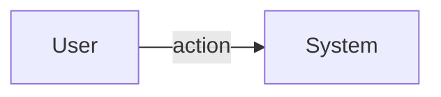

<!--
managed-by: sdd-workflow-kit
kit-version: 0.2.2
template: docs/templates/Feature-Template.md.tmpl
-->

# Feature: <Name>

## Purpose

## Scope

## Business Rules

## User Flows

## System Behaviour

## Diagram (Mermaid)

## Verification Plan

## Definition of Done

